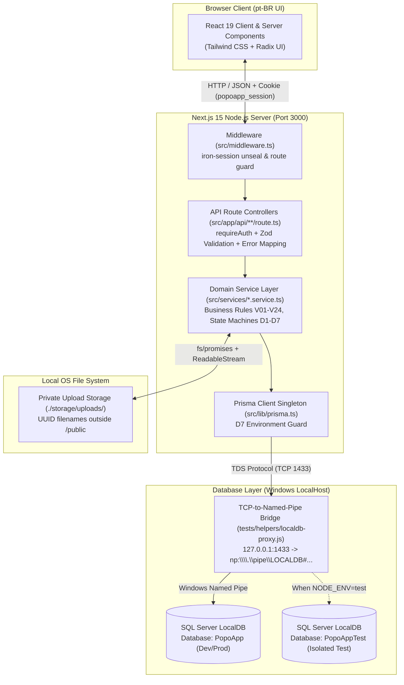
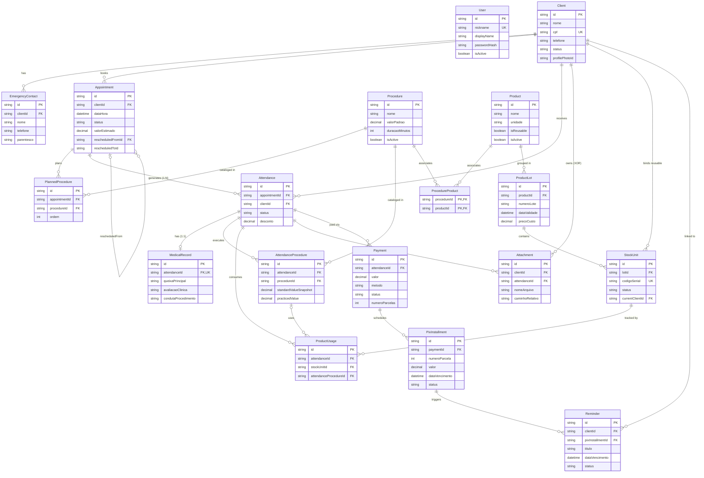

# PopoApp — Comprehensive Technical Architecture, Build & Engineering Report

> **Target Audience**: Principal / Staff AI Architecture, Build, Planning, and Coding Review Expert  
> **Purpose**: Provide a complete, code-accurate technical blueprint of PopoApp—covering how it was developed, its full technology stack, layered architecture, server/runtime model, database schema and engine constraints, security boundaries, testing infrastructure, and current architectural trade-offs to enable deep review, optimization, and future feature planning.

---

## 1. Executive Summary & Domain Context

**PopoApp** is a full-stack clinical management system designed for an aesthetic clinic and individual practitioner workflow (localized in Brazilian Portuguese, `pt-BR`). It manages the complete lifecycle of clinical operations:
- **Client & Emergency Contact Management** (mandatory Brazilian CPF checksum/uniqueness validation, clinical/financial history, profile photos).
- **Appointment Scheduling & Clinical Attendance Execution** (coupled via a strict state machine, separating *planned* procedures at booking from *actual performed* procedures during clinical execution).
- **Medical Records (`Prontuário`)** (strict 1:1 relationship with each Attendance).
- **Procedure Catalog & Historical Price Immutability** (snapshot of standard catalog prices vs. independent practiced prices and explicit attendance-level discounts).
- **Product Inventory, Lot Tracking & Physical Stock Unit Traceability** (enforcing single-use vs. reusable product rules at the individual physical serial unit level, permitting same-client reuse while blocking cross-client reuse).
- **Financial Engine, Multi-Method Payments & PIX Installment Schedules** (on-demand dynamic computation of totals and outstanding balances, credit card installment metadata vs. tracked PIX installment schedules with in-app reminders).
- **Authenticated Private Document & Image Storage** (local disk storage outside the public web root with XOR ownership between Client and Attendance).

---

## 2. How the Application Was Developed (Methodology & Engineering Lifecycle)

The application was engineered through a **spec-driven, milestone-gated, multi-agent software engineering methodology** across **7 Milestones (18 Phases)**:

1. **Specification & Invariant Mining**:
   - All domain rules were formalized into **7 Binding Architectural Decisions (`D1`–`D7`)**, **24 Critical Business Validations (`V01`–`V24`)**, and **Acceptance Criteria (`AC 51`–`AC 68`)** documented in `POPOAPP_DEVELOPMENT_SPEC.md` and `TEST_INFRA.md`.
2. **Progressive Milestone Execution (`M1` → `M7`)**:
   - **M1 (Foundation & Data Layer)**: Tooling, ESLint, Vitest, 16 Prisma domain models + custom SQL Server `CHECK` constraints (`CK_Attachment_Ownership`).
   - **M2 (Security & Core Catalogs)**: `bcrypt` + `iron-session` authentication, Next.js Edge/Node middleware, `ClientService` (MOD-11 CPF verification), `ProcedureService`, and private UUID file storage engine.
   - **M3 (Clinical Workflows & Traceability)**: `AppointmentService` (6 statuses), `AttendanceService` (`D1` state machine), `StockService` (physical unit serial tracking & client-bound reuse rules), and `MedicalRecordService`.
   - **M4 (Financial Engine & Reminders)**: `PaymentService` (`D2` dynamic financial calculations, PIX installment schedules), `ReminderService` (`D5` in-app reminders decoupled from financial truth), and `DashboardService`.
   - **M5 (Full `pt-BR` UI Integration & Clinical Seed)**: Complete removal of UI prototyping mocks; integration of all React views with live API routes; 1,180-line clinical seed script (`prisma/seed.ts`) covering end-to-end clinical scenarios A–E.
   - **M6 (E2E Verification & Adversarial Hardening)**: Elimination of `src/data/mock/`, execution of 5-tier real-database test suite (46 test files, 393 passing tests, 0 mocks).
   - **M7 (Forensic Audit & Production Readiness)**: Verification of clean production build (`next build`) and zero lint issues.

---

## 3. Technology Stack & Dependencies

### 3.1 Runtime & Core Frameworks
| Category | Technology | Version | Purpose |
| :--- | :--- | :--- | :--- |
| **Runtime** | Node.js | $\ge$ 18.18 LTS | Server runtime for Next.js, API routes, Prisma, and TCP proxy |
| **Language** | TypeScript | `^5.6.0` | Strict static typing across frontend, backend, and tests |
| **Full-Stack Framework** | Next.js (App Router) | `^15.0.0` | Hybrid Server/Client rendering, routing, middleware, and REST API route handlers |
| **UI Library** | React / React DOM | `^19.0.0` | Component rendering and client interactivity |

### 3.2 Backend, Data & Security Stack
| Category | Technology | Version | Purpose |
| :--- | :--- | :--- | :--- |
| **ORM** | Prisma (`@prisma/client` / `prisma`) | `^6.0.0` | Schema definition, migrations, type-safe SQL queries, interactive `$transaction` |
| **Database Engine** | Microsoft SQL Server LocalDB | 2019+ (`MSSQLLocalDB`) | Relational persistence, ACID transactions, `Decimal(10,2)` math, `CHECK` constraints |
| **Session Management** | `iron-session` | `^8.0.3` | Stateless/sealed AES-encrypted HTTP-only session cookies (`popoapp_session`) |
| **Password Hashing** | `bcrypt` | `^5.1.1` | Salted password hashing and verification |
| **Schema Validation** | `zod` | `^3.23.8` | Runtime payload/query parsing and input sanitization at API and form boundaries |

### 3.3 Frontend & Presentation Stack
| Category | Technology | Version | Purpose |
| :--- | :--- | :--- | :--- |
| **Styling** | Tailwind CSS + PostCSS + Autoprefixer | `^3.4.19` | Utility-first styling, responsive clinical workspaces |
| **Component Primitives** | Radix UI (`@radix-ui/react-*`) | `^1.1.x` / `^2.1.x` | Accessible Dialog, AlertDialog, Select, Tabs, DropdownMenu, Tooltip, ScrollArea |
| **Forms** | `react-hook-form` + `@hookform/resolvers` | `^7.53.0` | Client-side form state management bound to Zod schemas |
| **Animations & UI Utils** | `framer-motion`, `lucide-react`, `sonner`, `date-fns` | `^11.3`, `^0.460`, `^1.5`, `^4.1` | Transitions, iconography, toast notifications, and `pt-BR` date manipulation |

### 3.4 Testing & Quality Tooling
| Category | Technology | Version | Purpose |
| :--- | :--- | :--- | :--- |
| **Test Runner** | Vitest (`vitest`) | `^2.1.8` | Single-fork sequential integration/E2E test runner against isolated SQL Server DB |
| **Linter** | ESLint + `eslint-config-next` | `^8.0.0` / `^15.0.0` | Static analysis and code quality enforcement |

---

## 4. Server, Infrastructure & Runtime Topology



### Key Infrastructure Mechanics
1. **Next.js Monolithic Server (`next dev` / `next start`)**:
   - Serves both the React UI pages (`src/app/(authenticated)/*`, `src/app/login`) and the 50 REST API route handlers (`src/app/api/*`).
2. **SQL Server LocalDB TCP Proxy (`tests/helpers/localdb-proxy.js`)**:
   - **Why it exists**: Prisma's Rust query engine for SQL Server (`tiberius`) connects strictly over TCP/IP, whereas Windows SQL Server LocalDB (`MSSQLLocalDB`) listens dynamically on Windows Named Pipes (`np:\\.\pipe\LOCALDB#...\tsql\query`).
   - **How it works**: A lightweight Node.js `net` server listens on `127.0.0.1:1433`, resolves the active Named Pipe via `sqllocaldb info MSSQLLocalDB`, maintains a 5-second heartbeat socket so LocalDB does not auto-shutdown, and bidirectionally pipes TCP streams to the Named Pipe.
3. **Private Disk Storage (`./storage/uploads/`)**:
   - Stored outside `public/` so Next.js static file serving cannot expose clinical photos or medical attachments directly. Files are written with UUID filenames and streamed only through authenticated API routes (`/api/attachments/[id]` and `/api/clients/[id]/photo`).

---

## 5. Architectural Pattern: Layered Service Architecture (Next.js Adapted MVC)

Rather than placing database queries inside React Server Components or API routes, PopoApp enforces a strict **4-Layer Architecture**:

| Layer | Directory | MVC Equivalent | Responsibilities & Boundaries |
| :--- | :--- | :--- | :--- |
| **1. Presentation Layer** | `src/app/(authenticated)/`<br>`src/app/login/`<br>`src/components/` | **View (V)** | Renders `pt-BR` interfaces, manages modal/form state, formats currency/dates (`src/lib/format.ts`), and communicates with the backend via `fetch('/api/...')`. Never imports Prisma or domain services directly in client components. |
| **2. Controller / API Layer** | `src/app/api/**/route.ts`<br>`src/middleware.ts` | **Controller (C)** | Thin HTTP adapters. Authenticates requests (`requireAuth`), parses/validates input via `src/schemas/*.ts` (Zod), invokes `src/services/*.service.ts`, and translates `DomainError` subclasses into standard HTTP status codes (`400`, `401`, `404`, `409`, `422`, `500`). |
| **3. Service / Domain Layer** | `src/services/*.service.ts`<br>`src/schemas/*.ts`<br>`src/lib/errors.ts` | **Domain Model (M - Behavior)** | Pure TypeScript domain services (`AuthService`, `ClientService`, `AppointmentService`, `AttendanceService`, `ProcedureService`, `ProductService`, `StockService`, `MedicalRecordService`, `PaymentService`, `ReminderService`, `AttachmentService`, `DashboardService`). Encapsulates all 24 Critical Validations (`V01`–`V24`), multi-step Prisma `$transaction` workflows, and state transitions. |
| **4. Data Access & Persistence Layer** | `prisma/schema.prisma`<br>`prisma/migrations/`<br>`src/lib/prisma.ts` | **Data Model (M - State)** | Relational schema, foreign key cascade policies, indexes, `Decimal(10,2)` monetary storage, and engine-level SQL `CHECK` constraints. |

---

## 6. Database Architecture & Domain Data Model

### 6.1 Database Engine & Schema Overview
- **Engine**: Microsoft SQL Server (`provider = "sqlserver"`).
- **Primary Keys**: UUID strings (`@id @default(uuid())`).
- **Monetary Precision**: All prices, discounts, costs, and payment amounts use `@db.Decimal(10, 2)` to prevent floating-point drift.
- **Enums**: Implemented as indexed `NVARCHAR` columns validated at the Zod schema and Service layers (since SQL Server does not have a native `ENUM` type in Prisma).
- **SQL Server Cyclic Cascade Prevention**: Relationships sharing common ancestors (such as `Client -> Appointment -> Attendance -> ProductUsage`) explicitly use `onDelete: NoAction, onUpdate: NoAction` where required by SQL Server to prevent `multiple cascade paths` errors, while true composition children (`EmergencyContact`, `PlannedProcedure`, `MedicalRecord`, `PixInstallment`) use `onDelete: Cascade`.

### 6.2 Entity-Relationship Diagram (16 Models)



### 6.3 Custom Database Constraints (`CK_Attachment_Ownership`)
In addition to standard Prisma foreign keys and unique constraints, the migration `prisma/migrations/20261006000000_init_domain_models/migration.sql` enforces an engine-level XOR check constraint on the `Attachment` table:
```sql
ALTER TABLE [dbo].[Attachment] ADD CONSTRAINT [CK_Attachment_Ownership] CHECK (
    ([clientId] IS NOT NULL AND [attendanceId] IS NULL) OR
    ([clientId] IS NULL AND [attendanceId] IS NOT NULL)
);
```
This guarantees at the SQL Server engine level that an attachment belongs either to a `Client` OR to an `Attendance`, never both and never neither (`V14`, `AC 61`).

---

## 7. Core Business Rules & Binding Decisions (`D1`–`D7` & `V01`–`V24`)

1. **`D1` — Coupled Appointment & Attendance State Machine**:
   - **Appointment Statuses (6)**: `Agendado`, `Confirmado`, `Concluído`, `Cancelado`, `Não compareceu`, `Reagendado`. (`Em atendimento` is strictly prohibited per `V03`).
   - **Attendance Statuses (3)**: `Pendente`, `Realizado`, `Cancelado`.
   - Creating an `Appointment` atomically creates an initial `Attendance` in `Pendente` status (`V07`).
   - Canceling, marking no-show, or rescheduling an `Appointment` automatically transitions its pending `Attendance`(s) to `Cancelado`.
   - Rescheduling (`V04`) is atomic: marks the original appointment `Reagendado`, cancels its pending attendance, creates a new appointment (`Agendado`) linked via `rescheduledFromId`/`rescheduledToId`, copies planned procedures, and creates a fresh `Pendente` attendance.

2. **`D2` — Dynamic Financial Calculation & Price Immutability**:
   - When a procedure is added to an `Attendance` (`AttendanceProcedure`), the current catalog `Procedure.valorPadrao` is copied into `standardValueSnapshot`, while the clinician sets an independent `practicedValue` (`V08`, `V09`).
   - A difference between `standardValueSnapshot` and `practicedValue` does **not** count as an automatic discount (`V10`). Discounts (`Attendance.desconto`) must be entered explicitly (`V11`).
   - **Dynamic Totals**: `netTotal` ($\sum \text{practicedValue} - \text{desconto}$), `paidTotal`, and `outstandingBalance` are **computed dynamically on read** by `PaymentService` / `AttendanceService` and never stored as mutable columns that could go out of sync.

3. **`D3` — Planned vs. Executed Procedures Separation**:
   - `PlannedProcedure` belongs to `Appointment` (intent at booking).
   - `AttendanceProcedure` belongs to `Attendance` (clinical reality & billing basis). Can be prefilled from planned procedures via `/api/attendances/[id]/prefill` or modified independently.

4. **`D4` — Client CPF & Emergency Contacts**:
   - Mandatory Brazilian CPF validated with Modulo-11 check digits (`src/lib/cpf.ts`), normalized to 11 digits, and enforced as `@unique` in SQL Server.

5. **`D5` — Payment Installments & In-App Reminders Decoupling**:
   - **Credit Card Installments (`V21`)**: Stores `numeroParcelas` ($1..12$) on `Payment` and generates **zero** reminders.
   - **PIX Installment Schedules (`V22`)**: Creates `N` `PixInstallment` records with due dates and automatically generates `N` in-app `Reminder` records (`tipo = 'parcela_pix'`).
   - **Financial Truth Decoupling (`V23`)**: Marking a `Reminder` as `concluido` or `dispensado` only updates the reminder alert state—it **never** marks the `PixInstallment` or `Payment` as paid or alters the client's outstanding balance.

6. **`D6` — Private File Storage & Authenticated Streaming**:
   - 10MB file size limit, strict MIME allowlist (`image/jpeg`, `image/png`, `image/webp`, `application/pdf`), UUID disk naming, path-traversal protection, and streaming via `NextResponse` only after `requireAuth`.

7. **`D7` — Strict Database Isolation for Testing**:
   - `src/lib/prisma.ts` and `tests/helpers/db-client.ts` inspect `process.env.NODE_ENV === 'test'` and throw a fatal error if `DATABASE_URL` does not target `database=PopoAppTest`.

---

## 8. Complete API Endpoint Inventory (50 Route Handlers)

All routes under `src/app/api/` return structured JSON (`{ success: boolean, data?: ..., error?: string }`) and enforce authentication via both `src/middleware.ts` and `requireAuth(request)` (except `/api/auth/login` and `/api/auth/logout`).

| Domain | Endpoints (`src/app/api/...`) | Methods | Backing Service |
| :--- | :--- | :--- | :--- |
| **Auth** | `/api/auth/login`, `/api/auth/logout` | `POST` | `AuthService` + `iron-session` |
| **Clients** | `/api/clients`<br>`/api/clients/[id]`<br>`/api/clients/[id]/contacts`, `/api/clients/[id]/contacts/[contactId]`<br>`/api/clients/[id]/history`<br>`/api/clients/[id]/photo` | `GET, POST`<br>`GET, PUT, PATCH, DELETE`<br>`GET, POST, PUT, DELETE`<br>`GET`<br>`GET, POST, DELETE` | `ClientService`<br>`AttachmentService` |
| **Procedures** | `/api/procedures`<br>`/api/procedures/[id]` | `GET, POST`<br>`GET, PUT, PATCH, DELETE` | `ProcedureService` |
| **Appointments** | `/api/appointments`, `/api/appointments/[id]`<br>`/api/appointments/[id]/status`<br>`/api/appointments/[id]/confirm`<br>`/api/appointments/[id]/complete`<br>`/api/appointments/[id]/cancel`<br>`/api/appointments/[id]/no-show`<br>`/api/appointments/[id]/reschedule` | `GET, POST, PUT, PATCH`<br>`PATCH, POST` | `AppointmentService` |
| **Attendances** | `/api/attendances`, `/api/attendances/[id]`<br>`/api/attendances/[id]/status`, `/complete`, `/cancel`<br>`/api/attendances/[id]/prefill`<br>`/api/attendances/[id]/procedures`, `/procedures/[procId]`<br>`/api/attendances/[id]/discount`<br>`/api/attendances/[id]/usages`<br>`/api/attendances/[id]/record`<br>`/api/attendances/[id]/payments`, `/payments/pix-schedule` | `GET, POST, PUT, PATCH`<br>`POST, PATCH`<br>`POST`<br>`GET, POST, PUT, DELETE`<br>`PATCH, PUT`<br>`GET, POST, DELETE`<br>`GET, POST, PUT`<br>`GET, POST` | `AttendanceService`<br>`StockService`<br>`MedicalRecordService`<br>`PaymentService` |
| **Products & Stock** | `/api/products`, `/api/products/[id]`<br>`/api/products/[id]/lots`<br>`/api/lots/[id]`, `/api/lots/[id]/units`<br>`/api/stock/units`, `/api/stock/units/[id]` | `GET, POST, PUT, PATCH`<br>`GET, POST`<br>`GET, PUT, POST`<br>`GET, PATCH` | `ProductService`<br>`StockService` |
| **Financial & Payments** | `/api/financial/summary`<br>`/api/financial/transactions`<br>`/api/payments/[id]`<br>`/api/payments/installments/[id]/pay`<br>`/api/pix-installments/[id]/pay` | `GET`<br>`GET`<br>`GET, PATCH, DELETE`<br>`POST, PATCH` | `PaymentService`<br>`DashboardService` |
| **Reminders** | `/api/reminders`, `/api/reminders/dashboard`<br>`/api/reminders/[id]`, `/api/reminders/[id]/status` | `GET, POST`<br>`GET, PUT, PATCH, DELETE` | `ReminderService` |
| **Attachments** | `/api/attachments`<br>`/api/attachments/[id]` | `POST`<br>`GET, DELETE` | `AttachmentService` |
| **Dashboard** | `/api/dashboard/summary` | `GET` | `DashboardService` |

---

## 9. Frontend Architecture & User Interface (`src/app/(authenticated)/`)

The UI is localized in Brazilian Portuguese (`pt-BR`) and organized around an authenticated shell (`src/app/(authenticated)/layout.tsx`) with sidebar/header navigation (`src/components/layout/`):

- **`/` (`page.tsx`)**: Clinical & Financial Dashboard (KPI cards, revenue summary, upcoming appointments, low-stock alerts, pending PIX/clinical reminders widget).
- **`/clientes` & `/clientes/[id]`**: Client directory with CPF mask/validation, status filtering, profile photo upload, emergency contacts management, and a tabbed 360° client dossier (Appointments, Attendances, Medical History, Reusable Stock Units bound to the client, Financial statement, Attachments).
- **`/agenda`**: Interactive calendar supporting Day, Week, and Month views, appointment creation with planned procedures, and 1-click status transitions (`Confirmar`, `Concluir`, `Cancelar`, `Não compareceu`, `Reagendar`).
- **`/atendimentos` & `/atendimentos/[id]`**: Clinical execution workspace. Allows importing planned procedures, overriding practiced prices, applying explicit discounts, recording `ProductUsage` by scanning/selecting physical `StockUnit` serial codes, filling the 1:1 `Prontuário` (`MedicalRecord`), uploading clinical photos/documents, and registering multi-method payments or PIX installment schedules.
- **`/procedimentos`**: Aesthetic procedure catalog with category filters, standard duration, and base pricing.
- **`/produtos`**: Inventory management spanning Product definitions (`isReusable` flag), Lot intake (`ProductLot` with expiration dates and unit auto-generation), and individual physical `StockUnit` tracking (`Disponivel`, `EmUso`, `Esgotado`, `Descartado`).
- **`/financeiro`**: Accounts receivable, cash flow breakdown, payment registration, and PIX installment settlement.
- **`/lembretes`**: In-app reminder center with overdue/upcoming filters, priority badges, and status toggles (`pendente`, `concluido`, `dispensado`).

---

## 10. Testing Architecture & Verification Baseline (`tests/`)

The test suite is designed around **Opaque-Box, Zero-Mock Real Database Verification** using **Vitest** (`vitest.config.ts`):
- **Execution Mode**: `pool: 'forks'` with `singleFork: true`, `fileParallelism: false`, `maxConcurrency: 1` to guarantee deterministic sequential execution against `PopoAppTest` without cross-file deadlocks or table truncation races.
- **5-Tier Structure (46 Test Files, 393 Passing Tests)**:
  - `tests/tier1_features/` (20 files): Core feature coverage across models, services, storage, and UI/API flows.
  - `tests/tier2_boundaries/` (14 files): Boundary conditions (MOD-11 CPF edge cases, SQL `CK_Attachment_Ownership` XOR violations, decimal precision, expired lots, cross-client reuse blocks, credit card 0-reminder rule).
  - `tests/tier3_combinations/` (3 files): Cross-service state machine cascades and multi-method payment interactions.
  - `tests/tier4_workflows/` (1 file): Full end-to-end clinical workflows (Scenarios A through E from the specification).
  - `tests/tier5_adversarial/` (8 files): White-box adversarial stress tests (race conditions, malformed payloads, auth cookie tampering, path traversal attempts, transaction rollbacks).

---

## 11. Potential Areas for Architectural Review & Future Improvements

For an AI Architecture & Engineering Expert reviewing this project for next-stage evolution, scalability, and production hardening, the following areas are prime candidates for analysis:

1. **Database Deployment & Connection Architecture**:
   - *Current State*: Targets Windows SQL Server LocalDB via a custom TCP-to-Named-Pipe bridge (`tests/helpers/localdb-proxy.js`) and `integratedSecurity=true`.
   - *Review Opportunity*: Transitioning to containerized SQL Server (Linux Docker) or cloud-managed Azure SQL / PostgreSQL for cross-platform deployment, connection pooling, and eliminating the LocalDB Named Pipe proxy in production.

2. **Authentication, RBAC & Multi-Tenancy**:
   - *Current State*: Single-role authentication (`User` model with `iron-session` cookie) designed for an individual practitioner / single clinic.
   - *Review Opportunity*: Adding Role-Based Access Control (RBAC: Admin, Practitioner, Receptionist, Financial), audit logging (`AuditLog` table for clinical/medical record mutations), session revocation/refresh rotation, and multi-professional or multi-clinic tenant isolation (`clinicId`).

3. **Frontend Data Fetching & State Synchronization**:
   - *Current State*: Client components primarily use React `useState`/`useEffect` with native `fetch()` calls to `/api/*` endpoints.
   - *Review Opportunity*: Introducing TanStack Query (React Query) or SWR for client-side caching, optimistic UI updates, automatic revalidation, and deduplication, or leveraging Next.js Server Actions / RSC data fetching more heavily.

4. **File Storage Scalability & Backup**:
   - *Current State*: Local filesystem storage (`./storage/uploads/`) streamed through Node.js API routes.
   - *Review Opportunity*: Abstracting `AttachmentService` behind a storage provider interface (e.g., Local Disk vs. S3 / Azure Blob Storage / Cloudflare R2 with presigned URLs or encrypted at-rest storage for LGPD/HIPAA compliance).

5. **Observability, Rate Limiting & API Hardening**:
   - *Current State*: Console error logging and standard `DomainError` mapping; no rate limiting on `/api/auth/login`.
   - *Review Opportunity*: Adding structured logging (`pino`), OpenTelemetry tracing, login rate limiting / brute-force protection, and OpenAPI/Swagger schema generation from existing Zod schemas (`src/schemas/*`).

6. **Automated Background Jobs**:
   - *Current State*: Overdue PIX installments and reminders are evaluated dynamically on query.
   - *Review Opportunity*: Adding a scheduled cron worker for automated lot expiration warnings, daily backup snapshots, and optional external notification channels (if scope expands beyond `D5` in-app reminders).

---

## 12. Repository Directory Map

```text
PopoApp/
├── prisma/
│   ├── migrations/20261006000000_init_domain_models/migration.sql
│   ├── schema.prisma                # 16 SQL Server models
│   └── seed.ts                      # Comprehensive clinical seed (Scenarios A-E)
├── src/
│   ├── app/
│   │   ├── (authenticated)/         # Protected pt-BR clinical UI pages
│   │   │   ├── agenda/              # Calendar & scheduling UI
│   │   │   ├── atendimentos/        # Attendance list & [id] clinical workspace
│   │   │   ├── clientes/            # Client list & [id] 360° dossier
│   │   │   ├── financeiro/          # Financial dashboard & receivables
│   │   │   ├── lembretes/           # In-app reminders center
│   │   │   ├── procedimentos/       # Procedure catalog UI
│   │   │   ├── produtos/            # Product, Lot & StockUnit UI
│   │   │   ├── layout.tsx           # Authenticated shell layout
│   │   │   └── page.tsx             # Main KPI Dashboard
│   │   ├── api/                     # 50 REST API Route Handlers (Controllers)
│   │   ├── login/                   # Public login screen
│   │   └── layout.tsx               # Root HTML/Font/Toast layout
│   ├── components/                  # Reusable Radix UI + Tailwind components & modals
│   ├── i18n/                        # pt-BR dictionary & labels
│   ├── lib/                         # Core utilities (prisma.ts, session.ts, cpf.ts, errors.ts, format.ts)
│   ├── schemas/                     # Zod validation schemas (client, appointment, attendance, etc.)
│   ├── services/                    # 12 Domain Service classes (Pure business logic layer)
│   ├── types/                       # TypeScript domain interfaces & DTOs
│   └── middleware.ts                # Next.js request interceptor (iron-session verification)
├── storage/uploads/                 # Private UUID file storage (outside public/)
├── tests/
│   ├── helpers/                     # localdb-proxy.js, db-client.ts, test fixtures
│   ├── tier1_features/              # Core feature test suites
│   ├── tier2_boundaries/            # Boundary & constraint test suites
│   ├── tier3_combinations/          # Cross-feature interaction test suites
│   ├── tier4_workflows/             # End-to-end clinical scenario test suites
│   └── tier5_adversarial/           # Adversarial security & concurrency test suites
├── PROJECT.md                       # This comprehensive technical architecture report
├── POPOAPP_DEVELOPMENT_SPEC.md      # Authoritative domain specification
├── TEST_INFRA.md                    # Test architecture & V01-V24 traceability matrix
├── SETUP_GUIDE.md                   # Environment setup & installation guide
└── RESUME_GUIDE.md                  # Milestone completion & operational guide
```
